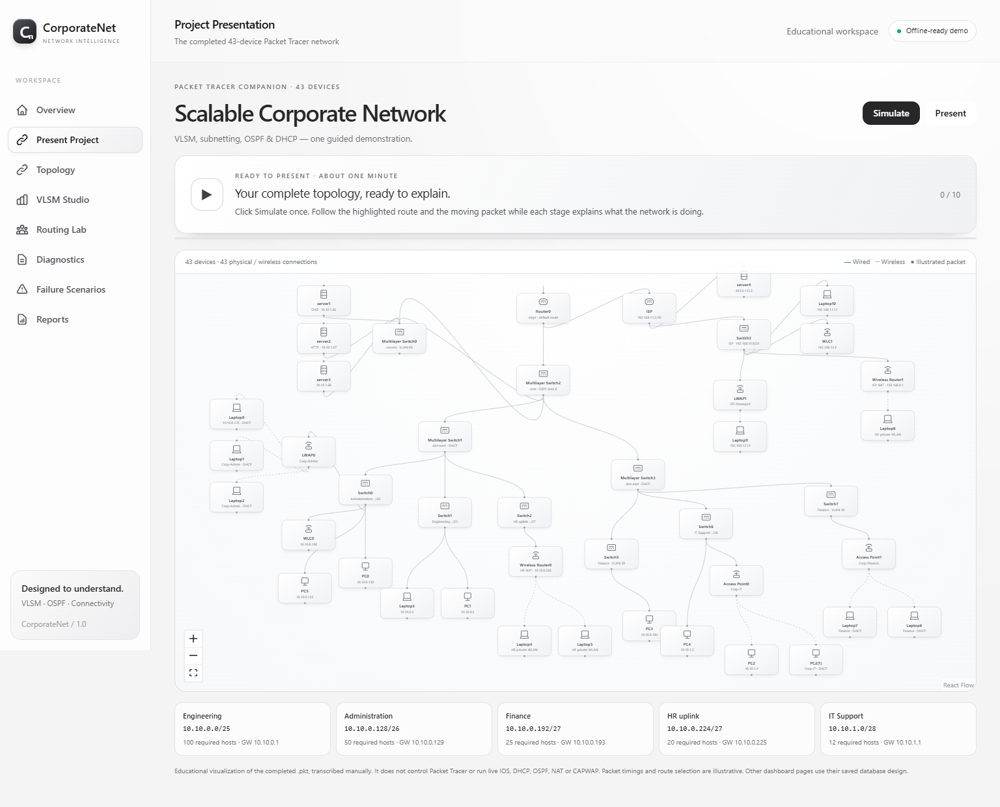

# CorporateNet

Scalable Corporate Network using **VLSM, subnetting, OSPF and DHCP**, with a completed 43-device Cisco Packet Tracer lab and a one-click browser presentation.

## Present the project

Requires Node.js 20+ and npm. In PowerShell:

```powershell
cd "D:\CODING\Web Developing\CorporateNet"
npm install
npm run dev:web
```

Open **http://localhost:5173/simulation**, click **Present**, then **Simulate**. Use Vite's printed port if 5173 is occupied. Keep the terminal open; Ctrl+C stops it. This page needs **no API or MongoDB**. Install dependencies before presenting.

The approximately one-minute sequence explains VLSM, DHCP, OSPF, DNS/HTTP, ISP access and a server-link failure/recovery. Pause/resume, replay, reset, zoom and device inspection are available. Escape exits presentation mode.



## Documentation

| Document | Use |
|---|---|
| [Presentation outline](docs/presentation-outline.md) | 12-slide faculty outline, timing, speaker notes and Q&A |
| [Present to sir](docs/present-to-sir.md) | Practical speaking script and live Packet Tracer steps |
| [Run and simulate](docs/run-and-simulate.md) | Startup, optional database mode, checks and troubleshooting |
| [Lab guide](network/packet-tracer/README.md) | Actual topology, services, wireless and observed checks |
| [Address plan](network/addressing/vlsm-plan.md) | Subnets, interfaces, gateways, remaining space and correct totals |
| [Architecture](docs/architecture.md) | Frontend, API and database boundaries |

## Actual lab and browser model

Open [Scalable_Corporate_Network_CN.pkt](network/packet-tracer/Scalable_Corporate_Network_CN.pkt) in **Packet Tracer 9.0.1 or a compatible newer version**. No Node.js/MongoDB is needed to open the lab. Let Realtime converge before testing; use Simulation with ARP/ICMP filters and Add Simple PDU to animate traffic.

The lab has four multilayer switches, two routers, seven access switches, four servers, two controllers, two lightweight APs, two standalone APs, two wireless routers, seven PCs and eleven laptops: **43 devices**. The browser model contains their **43 wired/wireless links**, including two core-to-server routed links.

| Department | Required hosts | Subnet | Gateway |
|---|---:|---|---|
| Engineering | 100 | 10.10.0.0/25 | 10.10.0.1 |
| Administration | 50 | 10.10.0.128/26 | 10.10.0.129 |
| Finance | 25 | 10.10.0.192/27 | 10.10.0.193 |
| HR uplink | 20 | 10.10.0.224/27 | 10.10.0.225 |
| IT Support | 12 | 10.10.1.0/28 | 10.10.1.1 |

The corporate /23 also contains the server /28 and five routed /30s: **308/512 addresses allocated (60.2%)**, **204 unallocated (39.8%)**. These are allocation figures, not active-host utilization. HR wireless clients use a private NAT LAN behind their corporate uplink.

OSPF process 1/area 0 connects west, core, east, servers and edge. The edge advertises its ISP default route; ISP uses a static return route. Corporate DNS is 10.10.1.66. The lab websites are `intranet.corporate.test` and `www.isp.test`. Corp-Admin and ISP-Managed are configured on the two controllers. All ISP services are simulated.

The browser model is manually transcribed in `apps/web/src/data/packetTracer.ts`. It illustrates graph paths and does not control the .pkt, run IOS, implement protocol timing, or synchronize changes automatically. No Cisco-specific MCP connection was available in the configuration session; Packet Tracer's native UI was used.

## Optional database dashboard

The remaining pages use MongoDB-backed saved designs. The default seed is the **older three-router R1–R2–R3 example**, not the completed 43-device lab. Do not use its R1/R2/R3 text configuration files to reconfigure the completed lab.

| Route | Behavior |
|---|---|
| `/simulation` | Local 43-device guided presentation; no API calls |
| `/` | Saved-design overview |
| `/topology` | Saved-design graph, route animation and link removal |
| `/vlsm` | Calculator and design saving through the API |
| `/routing` | Design-derived OSPF expectations and illustrative CLI |
| `/diagnostics` | Recorded directional test observations; does not send pings |
| `/scenarios` | Documented failure scenarios for a saved design |
| `/reports` | Saved-design report and Markdown export |

Run `npm run demo` to start both servers with a temporary seeded MongoDB process. The first run may download a MongoDB binary; data disappears on shutdown. For persistent storage, use the environment/setup instructions in [run-and-simulate](docs/run-and-simulate.md).

## Development and checks

```powershell
npm run build:web
npm run test --workspace=apps/web
```

`npm test` runs both workspaces; API tests require a temporary MongoDB binary. `npm run build` builds both workspaces. Rehearse the browser presentation manually using the steps in [the speaking script](docs/present-to-sir.md).

Representative Packet Tracer paths, DNS/HTTP and one server-link failure are documented in [the lab guide](network/packet-tracer/README.md). Exhaustive all-pairs/load/security and physical-hardware testing were not performed.

## Repository map

```text
apps/web/src/data/packetTracer.ts   43-device model and ten narrated stages
apps/web/src/pages/Presentation.tsx One-click presentation controller/map
apps/web/src/pages/                Database dashboard pages
apps/api/src/                      API, models, VLSM, records and reports
apps/api/src/scripts/seed-data.ts   Older three-router starter design
network/packet-tracer/             Completed .pkt and observed checks
network/addressing/                Completed-lab addressing plan
network/configs/                   Older R1/R2/R3 example text configs
docs/                             Guides, architecture and presentation
```
