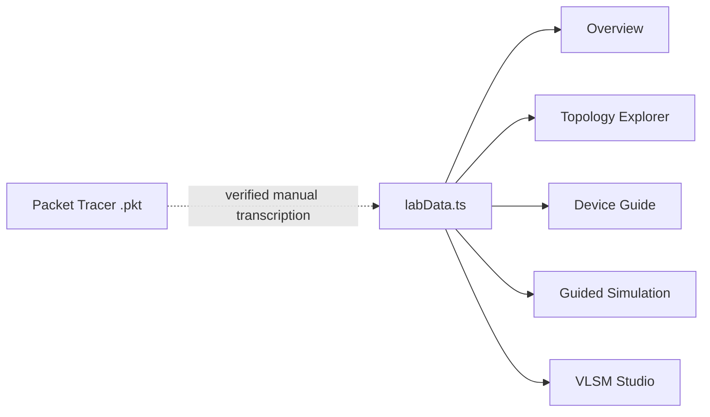

# CorporateNet architecture

## Two deliberate artifacts

| Artifact | Source of truth | Purpose | Runtime |
|---|---|---|---|
| Native network | `network/packet-tracer/Scalable_Corporate_Network_CN.pkt` | IOS configuration, protocol behavior, live packets, and evidence | Cisco Packet Tracer 9.0.1+ |
| Browser companion | `apps/web/src/data/labData.ts` | Explain the same 43-device topology and illustrate packet paths | React/Vite in a browser |

The repository is frontend-only. There is no API, database, server persistence, or second saved topology.



The browser does not control Packet Tracer. The separately installed local Packet Tracer MCP is an audit/configuration tool for the native application, not a website backend.

## Network layers

- **Access:** seven 2960 switches, autonomous/lightweight APs, WLCs, and WRT devices acting as Layer-2 bridges.
- **Distribution:** west serves Engineering, Administration, and HR; east serves Finance and IT; the server multilayer switch serves VLAN 60.
- **Core:** the core multilayer switch joins west, east, servers, and Router0 with routed /30 links and OSPF area 0.
- **Edge:** Router0 owns the default route and PAT; the ISP router provides simulated ISP-client and external-server networks.

The explanatory floor grouping is Floor 1 (Admin/Engineering/HR) and Floor 2 (Finance/IT). It is a logical presentation of the retained topology, not a physical site survey.

## Addressing and routing

Corporate addressing uses `10.10.0.0/23`. VLSM allocates the largest department first, followed by smaller departmental networks, the server /28, and five corporate routed /30 links. The WAN is `198.51.100.0/30`; the external server network is `203.0.113.0/24`.

OSPF process 1, area 0 router IDs:

| Device | Router ID |
|---|---|
| west | 1.1.1.1 |
| core | 2.2.2.2 |
| east | 3.3.3.3 |
| servers | 4.4.4.4 |
| edge | 5.5.5.5 |

The ISP is outside corporate OSPF and uses static routing. Router0 translates eligible corporate traffic to `198.51.100.1` with PAT. TEST-NET addresses are documentation ranges, not public Internet service.

## Wireless design

- `Corp-Admin`: WLC0 + LWAP0, bridged into the Administration subnet.
- `ISP-Managed`: WLC1 + LWAP1, bridged into the ISP-client subnet.
- Autonomous AP0/AP1 bridge IT and Finance wireless clients.
- WRT0/WRT1 use LAN Ethernet ports with their internal DHCP servers disabled; west/ISP DHCP provides client addressing.

An AP without a management IP is still a valid bridge but cannot originate ICMP. Verify its data plane with an associated client.

## Frontend implementation

Stack: React 18, TypeScript, Vite 5, React Router, React Flow, and Tailwind/CSS.

| Route | Behavior |
|---|---|
| `/` | Counts and addressing summary from local lab data |
| `/simulation` | Ten narrated stages with animated packet hops |
| `/topology` | Any-source/destination graph path and one-link failure illustration |
| `/device-guide` | Searchable purpose, justification, interfaces, and neighbors |
| `/vlsm` | Largest-first VLSM calculator running entirely in the browser |
| `/architecture` | This design summarized in the UI |

`labData.ts` contains devices, links, interfaces, positions, explanations, architecture text, VLSM logic, and demonstration stages. `utils/simulation.ts` contains the breadth-first path finder and fallback layout helper.

Packet movement is illustrative: it does not model IOS forwarding tables, ARP timing, OSPF convergence/cost/ECMP, DHCP broadcast fan-out, TCP state, NAT internals, or CAPWAP.

## Scalability and limits

Adding a department requires an available subnet, gateway/DHCP configuration, access uplink, and route advertisement. Address space, port count, bandwidth, AP capacity, and failure domains must all be reviewed.

This educational design still has single points of failure at the core, edge, and each distribution block. Two server links demonstrate alternate reachability but do not provide full campus high availability. Production evolution would add redundant cores/edges, first-hop redundancy, port channels, routed access or resilient trunks, security policy, monitoring, and capacity measurements.

## Validation

```powershell
npm run build
npm test
```

Automated tests validate the browser data and algorithms. Native verification is recorded separately in `network/packet-tracer/connectivity-matrix.csv` and the lab guide. Do not infer native pair success solely from a browser graph path.
