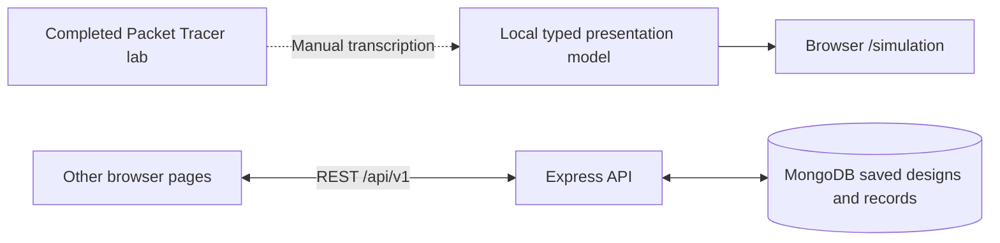

# CorporateNet architecture

## Three separate artifacts

| Artifact | Source of truth | Purpose | Required runtime |
|---|---|---|---|
| Completed network | `network/packet-tracer/Scalable_Corporate_Network_CN.pkt` | Configured 43-device protocol simulation | Cisco Packet Tracer 9.0.1 or compatible newer version |
| Browser presentation | `apps/web/src/data/packetTracer.ts` | Manually transcribed topology and narrated path illustration | Vite/React; no API or MongoDB |
| Saved-design dashboard | MongoDB NetworkDesign/TestRun/Scenario records | Calculations, editable designs, recorded observations and reports | Frontend + Express API + MongoDB |

The API seed in `apps/api/src/scripts/seed-data.ts` is the older R1–R2–R3 design with eight modeled devices and seven links. It is not automatically replaced by the completed lab. Saving a design in VLSM Studio does not alter the .pkt or the presentation model.



There is no live control or synchronization arrow between the browser/API and Packet Tracer. No Cisco-specific MCP connection was available in the configuration session; native UI configuration was used. No CLI evidence import/collector feature is implemented.

## Frontend

Stack: React 18, TypeScript, Vite 5, React Router, React Flow, Recharts and Tailwind/CSS. State uses React hooks; network requests use the typed Fetch client in `apps/web/src/api/client.ts`.

| Route | Component / behavior | Data |
|---|---|---|
| `/simulation` | `Presentation.tsx`: guided 43-device walkthrough | Local model |
| `/` | Overview | Latest selected/saved design data |
| `/topology` | Source/destination paths, link removal, animation | Saved links |
| `/vlsm` | Largest-first calculator; save a connected design | API |
| `/routing` | Design-derived route/neighbor expectations and illustrative CLI | Saved interfaces/OSPF metadata |
| `/diagnostics` | Directional ping-observation matrix and manual recording | TestRun records |
| `/scenarios` | Documented failure scenarios | Scenario records |
| `/reports` | Report generation and Markdown export | Saved design and records |

### Presentation implementation

- `data/packetTracer.ts` contains device names, positions, addresses, port links, five department cards and ten narrated stages.
- `Presentation.tsx` owns timer/progress, pause/resume, replay/reset, expanded presentation mode and device inspection.
- React Flow renders 43 devices and 43 physical/wireless links. Existing breadth-first `findPath` from `utils/simulation.ts` calculates example routes with one optional failed link.
- Stages cover VLSM; DHCP request/response; OSPF overview; DNS query/reply; HTTP; ISP ICMP; server-link failure; recovery.
- Packet dots advance between hops. Timings, route choice and failure recomputation are illustrative. The graph does not implement IOS forwarding, OSPF cost/timers/ECMP, DHCP broadcast fan-out, TCP, NAT or CAPWAP.
- The “primary”/“backup” labels select an example failure path; they do not define an active/standby routing policy in the lab.
- Presentation mode hides the surrounding dashboard; Escape exits. Reduced-motion styling removes packet movement. The header skips its API health request on `/simulation`.

### Saved-design topology

`Topology.tsx` and `utils/simulation.ts` render the current saved design, calculate graph reachability and allow link-removal demonstrations. A chain design becomes partitioned when a bridge link is removed; the completed lab's parallel server links are a different case. Neither browser graph sends real packets.

## Backend and persistence

Stack: Node.js 20+, Express, TypeScript, Mongoose, Zod, Pino, Helmet, CORS and rate limiting.

- `src/routes/`: designs/VLSM, tests and scenarios routes.
- `src/services/`: design operations, VLSM arithmetic, directional observations, scenarios and report generation.
- `src/models/`: NetworkDesign with embedded department/device/interface/link arrays; TestRun and Scenario with design references.
- `src/middleware/`: validation and centralized error handling.
- `src/scripts/demo.ts`: disposable seeded MongoDB runtime; `seed.ts` seeds the configured persistent database.

Test outcomes are recorded observations with evidence type and notes. The API does not execute ping or router commands. Metadata and illustrative CLI must not be treated as live verified state.

### Main endpoints

All paths below are relative to `/api/v1`.

| Method | Path | Purpose |
|---|---|---|
| GET | `/health` | API health response |
| GET / POST | `/designs` | List / create designs |
| GET / PATCH / DELETE | `/designs/:id` | Read / update / delete design |
| POST | `/vlsm/calculate` | Calculate subnet allocation |
| GET | `/designs/:id/topology` | Transform saved topology |
| GET | `/designs/:id/routes` | Saved/derived routing information |
| GET | `/designs/:id/report` | Report-ready design and observations |
| GET / POST | `/tests` | List / record observations; designId in filter/body |
| GET | `/tests/matrix?designId=...` | Latest directional ping outcomes |
| GET / POST | `/scenarios` | List / create failure records; designId in filter/body |

Individual `/tests/:id` and `/scenarios/:id` routes support GET/PATCH/DELETE. `/designs/vlsm/calculate` is also implemented as an alias of `/vlsm/calculate`. Successful JSON responses use `{ success: true, data, meta }`; errors use `{ success: false, error: { code, message, details? } }`. `/designs/:id/report?format=markdown` returns Markdown text rather than JSON.

### VLSM

The API engine is `apps/api/src/services/vlsm.ts`. It parses IPv4/CIDR, sorts requested-plus-reserved capacity largest-first, includes network/broadcast addresses, aligns each block, checks bounds/overlap and decomposes remaining space. Invalid/insufficient allocations return errors. The frontend has calculator helpers and regression tests; calculator results do not push configuration to lab devices.

## Running and building

```powershell
npm run dev:web                          # Presentation-only frontend
npm run demo                             # API + frontend; temporary old seed
npm run dev                              # API + frontend; configured database
npm run build                            # Both workspaces
npm run start --workspace=apps/api        # Built API only
npm run preview --workspace=apps/web      # Built frontend preview
```

There is no root `npm run start` script. Vite proxies `/api` to localhost:3000 by default; `API_PROXY_TARGET` can override its target. `VITE_API_BASE_URL` defaults to `/api/v1`. Production serving/proxy/TLS configuration must be provided by the hosting environment; this repository has not been deployed as part of this work.

The API reads `MONGODB_URI`, `PORT`, `NODE_ENV`, `WEB_ORIGIN` and rate-limit settings. Keep database credentials in server environment files; never use a `VITE_*` variable for secrets. See [run-and-simulate](run-and-simulate.md) for non-overwriting setup commands.

## Validation and limits

Frontend unit/component tests run with `npm run test --workspace=apps/web`. API unit/integration suites use a temporary MongoDB process. Rehearse browser interactions using [the presentation script](present-to-sir.md). Authentication, multi-tenancy, live telemetry, Packet Tracer integration, measured performance guarantees and real hardware support are not implemented or validated features.
